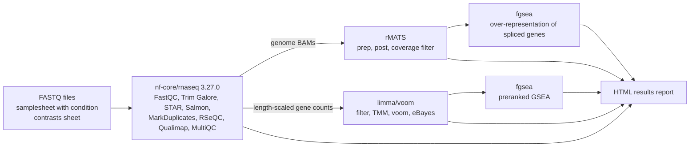

# rnaseq-splice

[](https://github.com/mattjarvis123/rnaseq-splice/actions/workflows/ci.yml)
[](https://github.com/mattjarvis123/rnaseq-splice/actions/workflows/lint.yml)
[](https://www.nextflow.io/)
[](https://www.docker.com/)
[](https://apptainer.org/)
[](https://github.com/nf-core/rnaseq/releases/tag/3.27.0)
[](LICENSE)

**rnaseq-splice** is a Nextflow pipeline for bulk RNA-seq that goes from FASTQ files to differential expression,
differential splicing, gene set enrichment and an interactive HTML results report in a single run.

It is built on [nf-core/rnaseq 3.27.0](https://github.com/nf-core/rnaseq/releases/tag/3.27.0), which provides read QC,
trimming, alignment, quantification and quality control, and adds:

- **Differential splicing** with [rMATS](https://github.com/Xinglab/rmats-turbo) (ported from
  [nf-core/rnasplice 2.0.0](https://github.com/nf-core/rnasplice/releases/tag/2.0.0)), with a read-coverage filter and
  FDR recalculation on the events that pass it.
- **Differential expression** with [limma/voom](https://bioconductor.org/packages/limma/) (TMM normalisation, voom
  weights, empirical Bayes moderation), using the nf-core `limma/differential` module.
- **Gene set enrichment** with [fgsea](https://bioconductor.org/packages/fgsea/): preranked GSEA of the limma results and
  over-representation analysis of the differentially spliced genes, against any MSigDB-style GMT files.
- **A results report**: a self-contained HTML dashboard with QC, sample structure, volcano and MA plots, splicing event
  views, cross-contrast comparisons, gene set results, KEGG pathway maps and a gene lookup.

All additions are opt-in. Without `--rmats`, `--limma` or `--gsea` the pipeline behaves exactly like nf-core/rnaseq 3.27.0.

**Example output:** [ENCODE U2AF2 knockdown report](https://mattjarvis123.github.io/rnaseq-splice/) (K562 and HepG2,
public data; see [Validation](#validation)).

## Pipeline overview



Every comparison in the contrasts sheet gets both differential expression and differential splicing results, so the
two can be compared gene by gene.

## Quick start

1. Install [Nextflow](https://www.nextflow.io/docs/latest/install.html) (>= 25.10.4) and
   [Docker](https://docs.docker.com/engine/installation/) or [Apptainer/Singularity](https://apptainer.org/).

2. Check that everything works with the built-in test profile, a small public yeast dataset with rMATS and limma
   switched on:

   ```bash
   nextflow run mattjarvis123/rnaseq-splice -r main -profile test_rmats,docker --outdir test_results
   ```

3. Run your own data. Write the settings in a parameters file (recommended: see
   [Command-line booleans](docs/splice_usage.md#command-line-booleans)):

   ```yaml title="params.yaml"
   input: samplesheet.csv
   contrasts: contrasts.csv
   fasta: GRCh38.primary_assembly.genome.fa.gz
   gtf: gencode.v46.primary_assembly.annotation.gtf.gz
   outdir: results

   rmats: true
   rmats_read_len: 100 # your read length
   limma: true
   gsea: true
   gsea_gmt: h.all.v2026.2.Hs.symbols.gmt,c2.cp.reactome.v2026.2.Hs.symbols.gmt,c2.cp.kegg_legacy.v2026.2.Hs.symbols.gmt
   ```

   ```bash
   nextflow run mattjarvis123/rnaseq-splice -r main -profile docker -params-file params.yaml
   ```

   Use a release tag (for example `-r 1.0.0`) instead of `main` for reproducible runs once one is available.

### Inputs

The samplesheet is the [nf-core/rnaseq samplesheet](https://nf-co.re/rnaseq/3.27.0/docs/usage#samplesheet-input) plus a
`condition` column:

```csv title="samplesheet.csv"
sample,fastq_1,fastq_2,strandedness,condition
CTRL_REP1,ctrl1_R1.fastq.gz,ctrl1_R2.fastq.gz,auto,CTRL
CTRL_REP2,ctrl2_R1.fastq.gz,ctrl2_R2.fastq.gz,auto,CTRL
CTRL_REP3,ctrl3_R1.fastq.gz,ctrl3_R2.fastq.gz,auto,CTRL
KD_REP1,kd1_R1.fastq.gz,kd1_R2.fastq.gz,auto,KD
KD_REP2,kd2_R1.fastq.gz,kd2_R2.fastq.gz,auto,KD
KD_REP3,kd3_R1.fastq.gz,kd3_R2.fastq.gz,auto,KD
```

The contrasts sheet lists the comparisons, shared by rMATS and limma:

```csv title="contrasts.csv"
contrast,treatment,control
KD_vs_CTRL,KD,CTRL
```

`treatment` and `control` must match values in the `condition` column. Fold changes and ΔPSI are always
treatment minus control. Gene set enrichment needs GMT files keyed by gene symbol, such as the
[MSigDB](https://www.gsea-msigdb.org/gsea/msigdb) `*.symbols.gmt` files.

## Parameters added by this pipeline

| Parameter                                          | Default      | Description                                                                                                                                         |
| -------------------------------------------------- | ------------ | --------------------------------------------------------------------------------------------------------------------------------------------------- |
| `--contrasts`                                      |              | Contrasts sheet (`contrast,treatment,control`). Required with `--rmats` or `--limma`.                                                               |
| `--rmats`                                          | `false`      | Run rMATS differential splicing. Needs a genome aligner (default `star_salmon`).                                                                    |
| `--rmats_read_len`                                 | `40`         | Read length given to rMATS. **Set this to your read length.**                                                                                       |
| `--rmats_min_reads`                                | `10`         | Keep events with at least this many junction reads (inclusion + skipping) in every replicate of both conditions, then recompute the FDR. `0` = off. |
| `--rmats_splice_diff_cutoff`                       | `0.0001`     | rMATS `--cstat`.                                                                                                                                    |
| `--rmats_paired_stats`                             | `false`      | Paired model (PAIRADISE); pairs the n-th treatment and control samples in samplesheet order.                                                        |
| `--rmats_novel_splice_site`                        | `false`      | Detect unannotated splice sites (with `--rmats_min_intron_len`, `--rmats_max_exon_len`).                                                            |
| `--limma`                                          | `false`      | Run limma/voom differential expression.                                                                                                             |
| `--limma_min_count`                                | `10`         | Keep genes with at least this many counts in at least as many samples as the smallest condition.                                                    |
| `--limma_robust`                                   | `false`      | Robust empirical Bayes moderation.                                                                                                                  |
| `--gsea` / `--gsea_gmt`                            | `false` /    | Run fgsea on the limma and rMATS results, with these comma-separated GMT files.                                                                     |
| `--gsea_fdr`                                       | `0.05`       | Adjusted p-value cut-off for enriched gene sets.                                                                                                    |
| `--gsea_rank_by`                                   | `t`          | Rank genes by the moderated `t` statistic or by `logFC`.                                                                                            |
| `--gsea_splicing_fdr` / `--gsea_splicing_dpsi`     | `0.01` / `0` | Event cut-offs used to build the spliced-gene lists.                                                                                                |
| `--report_de_fdr` / `--report_de_lfc`              | `0.01` / `0` | Cut-offs the report uses to call differentially expressed genes.                                                                                    |
| `--report_splicing_fdr` / `--report_splicing_dpsi` | `0.01` / `0` | Cut-offs the report uses to call differentially spliced events.                                                                                     |
| `--report_kegg_maps` / `--report_kegg_cache`       | `true` /     | Draw KEGG maps for significant KEGG gene sets; reuse map files from this folder.                                                                    |
| `--skip_report`                                    | `false`      | Skip the HTML report.                                                                                                                               |

The pipeline never filters results by significance: every tested gene, event and gene set is written out, and the
report cut-offs only affect what the report highlights. All nf-core/rnaseq parameters still apply; see the
[nf-core/rnaseq 3.27.0 parameter documentation](https://nf-co.re/rnaseq/3.27.0/parameters). Full details are in
[docs/splice_usage.md](docs/splice_usage.md).

## Outputs

In addition to the standard [nf-core/rnaseq outputs](https://nf-co.re/rnaseq/3.27.0/docs/output):

```
results/
├── star_salmon/
│   ├── rmats/<contrast>/            rMATS tables per event type (SE, MXE, A3SS, A5SS, RI)
│   │   └── filtered/                coverage-filtered tables with recomputed FDR
│   ├── limma/<contrast>/            limma/voom results, voom log-CPM, mean-difference plot, fitted model
│   └── gsea/<contrast>/             fgsea results for expression and splicing
└── report/
    ├── rnaseq_splice_report.html    the results report
    └── rnaseq_splice_report_tables/ full tables behind the report, and KEGG map images
```

See [docs/splice_output.md](docs/splice_output.md) for a description of every file and of the report pages.

## Validation

The pipeline was checked against a public positive control: ENCODE shRNA knockdowns of the splicing factor U2AF2 in
K562 ([ENCSR904CJQ](https://www.encodeproject.org/experiments/ENCSR904CJQ/)) and HepG2
([ENCSR426UUG](https://www.encodeproject.org/experiments/ENCSR426UUG/)) cells, compared with ENCODE's own processed
differential expression and rMATS results ([Van Nostrand _et al._, 2020](https://doi.org/10.1038/s41586-020-2077-3)).
In K562, log2 fold changes agreed with ENCODE's at r = 0.87 and ΔPSI values of matched splicing events at
r = 0.96–0.98, with the pipeline detecting more significant genes and events than ENCODE's older tool versions.
The [example report](https://mattjarvis123.github.io/rnaseq-splice/) shows the results of this run.

## Running on a cluster or shared storage

The pipeline runs on a laptop, a shared server or an HPC cluster with the **SLURM** or **PBS** (PBS Pro, Torque/OpenPBS)
scheduler, where Nextflow submits every task as its own job. Ready-to-edit templates are in
[conf/examples/](conf/examples/):

| Template                                     | For                                                     |
| -------------------------------------------- | ------------------------------------------------------- |
| `local_docker.config`                        | Laptop or workstation with Docker                       |
| `server_apptainer.config`                    | Shared Linux server without a scheduler, with Apptainer |
| `slurm_apptainer.config` + `submit_slurm.sh` | SLURM cluster with Apptainer                            |
| `pbs_apptainer.config` + `submit_pbs.sh`     | PBS Pro or Torque/OpenPBS cluster with Apptainer        |

```bash
# SLURM: edit the partition, account and paths, then submit the pipeline's head job
sbatch submit_slurm.sh
```

Institutional profiles from [nf-core/configs](https://github.com/nf-core/configs) also work (`-profile <institution>`).
[docs/splice_usage.md](docs/splice_usage.md#running-on-a-cluster-or-shared-storage) covers shared filesystems,
container caches, compute nodes without internet access and network storage.

## Repository layout

The pipeline follows the nf-core layout. Code added on top of nf-core/rnaseq lives in its own files where possible:

| Addition                                  | Source                                                      | Location                                                                                                                |
| ----------------------------------------- | ----------------------------------------------------------- | ----------------------------------------------------------------------------------------------------------------------- |
| rMATS subworkflow (prep, BAM lists, post) | nf-core/rnasplice 2.0.0                                     | `subworkflows/local/rmats/`, `modules/nf-core/rmats/prep/`, `modules/local/rmats/post/`, `modules/local/createbamlist/` |
| rMATS coverage filter                     | new                                                         | `modules/local/rmats/filter/`, `bin/rmats_filter.R`                                                                     |
| limma/voom subworkflow                    | nf-core/modules `custom/matrixfilter`, `limma/differential` | `subworkflows/local/differential_limma/`, `modules/nf-core/{custom/matrixfilter,limma/differential}/`                   |
| Gene set enrichment                       | new (fgsea)                                                 | `subworkflows/local/gsea/`, `modules/local/fgsea/`, `bin/fgsea_de.R`, `bin/fgsea_splicing.R`                            |
| Results report                            | new (R Markdown, flexdashboard)                             | `modules/local/rnaseq_splice_report/`, `assets/report/`                                                                 |
| Process settings                          | ported from nf-core/rnasplice, and new                      | `conf/modules/{rmats,limma,gsea,report}.config`                                                                         |
| `condition` column and contrasts sheet    | nf-core/rnasplice                                           | `assets/schema_input.json`, `assets/schema_contrasts.json`                                                              |
| Test profile                              | new                                                         | `conf/test_rmats.config`, `assets/test/`                                                                                |

Edits to upstream files are limited to small blocks in `workflows/rnaseq/main.nf`, `nextflow.config`,
`nextflow_schema.json`, `assets/schema_input.json` and `modules.json`, so new nf-core/rnaseq releases can be merged in:

```bash
git remote add upstream https://github.com/nf-core/rnaseq.git   # once
git fetch upstream --tags
git merge 3.28.0   # the release to merge
```

## Credits

rnaseq-splice is developed by [Matt Jarvis](https://github.com/mattjarvis123).

It is built on [nf-core/rnaseq](https://github.com/nf-core/rnaseq) 3.27.0, originally written at the National Genomics
Infrastructure (SciLifeLab) by Phil Ewels and Rickard Hammarén, re-written in Nextflow DSL2 by Harshil Patel, and
maintained by Jonathan Manning and the nf-core community; and on the rMATS components of
[nf-core/rnasplice](https://github.com/nf-core/rnasplice) 2.0.0, originally written by the bioinformatics team at Zifo
RnD Solutions. Both are MIT-licensed.

## Citations

If you use rnaseq-splice, please cite the pipelines it is built on:

> **nf-core/rnaseq.** doi: [10.5281/zenodo.1400710](https://doi.org/10.5281/zenodo.1400710)
>
> **nf-core/rnasplice.** doi: [10.5281/zenodo.8424632](https://doi.org/10.5281/zenodo.8424632)
>
> **The nf-core framework.** Ewels PA, Peltzer A, Fillinger S, _et al._ _Nat Biotechnol._ 2020;38(3):276-278. doi: [10.1038/s41587-020-0439-x](https://dx.doi.org/10.1038/s41587-020-0439-x)

and the tools it uses, listed in [CITATIONS.md](CITATIONS.md).

## License

[MIT](LICENSE). The upstream nf-core copyright notice is kept alongside the copyright for the additions.
